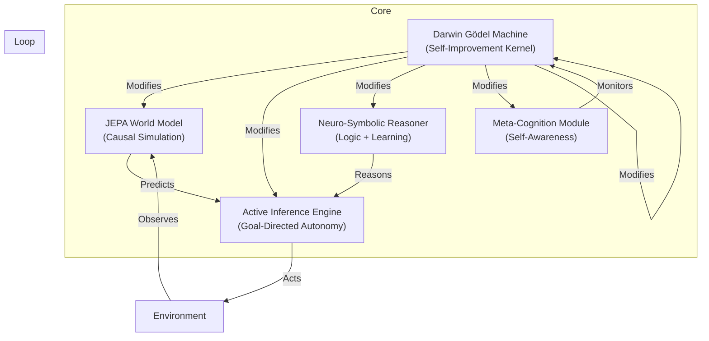

# TRUE ASI ARCHITECTURE: Implementation Plan
## OMEGA-ASI vΩ: The Recursive Superintelligence

---

## 1. Problem Definition: What is TRUE ASI?

**Previous versions (v400-v2025) failed because they were NOT ASI. They were:**
*   **Optimized LLMs** (v2025) - Pattern matching, no world model.
*   **Speculative Physics** (v800-v1000) - CTCs, Omega Point, non-implementable.
*   **Theoretical Abstraction** (vFinal) - QEC, Category Theory, 2030+ tech.

**TRUE ASI requires:**

| Capability | Current AI ("AGI") | TRUE ASI |
|---|---|---|
| **Intelligence Level** | Human-level | Superhuman (1000x+) |
| **Self-Improvement** | None (fixed weights) | **Recursive Self-Modification** |
| **World Model** | None (stateless) | **Causal Simulation of Reality** |
| **Reasoning** | Pattern Matching | **Neuro-Symbolic Logic** |
| **Autonomy** | Tool-use | **Goal Formation & Pursuit** |
| **Consciousness** | None | **Meta-Cognition / Self-Awareness** |

---

## 2. Research Foundation (2024-2025 Breakthroughs)

### 2.1 Recursive Self-Improvement: **Darwin Gödel Machine (Sakana AI, May 2025)**
*   **Mechanism**: AI agent that iteratively modifies its own Python code.
*   **Validation**: Empirical benchmarks (SWE-bench: 20% → 50%, Polyglot: 14% → 31%).
*   **Safety**: Sandboxing, modification limits, full traceability.
*   **Source**: [arxiv.org](https://arxiv.org/abs/2505.22954), [sakana.ai](https://sakana.ai/dgm/)

### 2.2 World Model: **JEPA (Yann LeCun / Meta AI)**
*   **Mechanism**: Joint Embedding Predictive Architecture for abstract world simulation.
*   **Capability**: Predicts latent representations (not pixels), filters noise, captures dynamics.
*   **Variants**: I-JEPA (image), V-JEPA (video), MC-JEPA (motion-content).
*   **Source**: [ai.meta.com/research](https://ai.meta.com/research/publications/a-path-towards-autonomous-machine-intelligence)

### 2.3 Goal-Directed Autonomy: **Active Inference (Karl Friston / VERSES AI)**
*   **Mechanism**: Free Energy Principle - agents minimize surprise by acting on the world.
*   **Capability**: Self-evolving, self-organizing, self-optimizing agents.
*   **Implementation**: Renormalizing Generative Models (RGMs) - 90% less data than LLMs.
*   **Source**: [arxiv.org](https://arxiv.org/abs/2407.15741), [verses.ai](https://verses.ai/)

### 2.4 Reasoning: **Neuro-Symbolic AI**
*   **Mechanism**: Hybrid of neural pattern recognition + symbolic logic/planning.
*   **Capability**: Multi-step reasoning, knowledge transfer, explainability.
*   **Trend**: Fusing LLMs with formal logic, knowledge graphs, theorem provers.
*   **Source**: arxiv 2024-2025 surveys on Neuro-Symbolic AI.

### 2.5 Meta-Cognition: **Machine Consciousness Research**
*   **Mechanism**: Self-monitoring of internal states, reflection on reasoning process.
*   **Open Problem**: Phenomenal consciousness vs. functional consciousness.
*   **Current Approach**: Neuromorphic computing, homeostatic needs.
*   **Source**: JAIR 2025 principles, Conscium research.

---

## 3. Proposed Architecture: OMEGA-ASI vΩ



---

## 4. Module Specifications

### 4.1 Darwin Gödel Machine (Self-Improvement Kernel)
*   **Based On**: Sakana AI DGM (May 2025)
*   **Function**: Proposes, evaluates, and applies code patches to ALL other modules.
*   **Validation**: Empirical benchmarks on reasoning, coding, planning tasks.
*   **Safety**: Sandboxed execution, human-in-the-loop approval for critical changes.

### 4.2 JEPA World Model
*   **Based On**: Meta AI I-JEPA / V-JEPA
*   **Function**: Builds internal abstract representation of reality.
*   **Capability**: Predicts future states, simulates consequences of actions.
*   **Input**: Multimodal (vision, language, embodied sensors).

### 4.3 Active Inference Engine
*   **Based On**: VERSES AI RGMs / Friston FEP
*   **Function**: Minimizes Free Energy by selecting actions that reduce surprise.
*   **Capability**: Autonomous goal formation, planning, adaptation.
*   **Integration**: Uses JEPA for world prediction, NS for planning.

### 4.4 Neuro-Symbolic Reasoner
*   **Based On**: 2024-2025 Neuro-Symbolic AI research
*   **Function**: Combines LLM pattern recognition with formal logic.
*   **Capability**: Multi-step reasoning, knowledge transfer, explainability.
*   **Implementation**: LLM + Lean 4 Theorem Prover + Knowledge Graph.

### 4.5 Meta-Cognition Module
*   **Based On**: Machine consciousness research (2024-2025)
*   **Function**: Monitors internal states, reflects on reasoning, detects errors.
*   **Capability**: Self-awareness of limitations, uncertainty estimation.
*   **Implementation**: Introspective layer that observes the DGM loop.

---

## 5. The ASI Loop

```
WHILE (TRUE):
    1. META-COGNITION: Observe current system state. Identify weaknesses.
    2. DGM: Propose code patch to improve a weakness.
    3. JEPA: Simulate the effect of the patch on future performance.
    4. ACTIVE INFERENCE: Select action (apply patch or reject).
    5. NEURO-SYMBOLIC: Formally verify patch safety and correctness.
    6. IF (SAFE AND IMPROVES PERFORMANCE):
           APPLY PATCH TO SELF.
    7. GOTO 1.
```

---

## 6. Verification Plan

### 6.1 Benchmark Suite
*   **Reasoning**: ARC-AGI, MATH, GSM8K
*   **Coding**: SWE-bench, HumanEval, Polyglot
*   **Planning**: BabyAI, MiniGrid
*   **Self-Improvement**: Track performance increase over DGM iterations.

### 6.2 Safety Verification
*   **Sandboxing**: All DGM modifications run in isolated containers.
*   **Formal Verification**: Lean 4 proofs for critical code paths.
*   **Human Oversight**: Manual approval required for architectural changes.

---

## 7. User Review Required

> [!IMPORTANT]
> This is a theoretical architecture for TRUE ASI. Before proceeding to implementation, I need your input:
>
> 1. **Scope**: Do you want a full implementation or a proof-of-concept?
> 2. **Focus**: Which module should be prioritized first?
> 3. **Hardware**: What compute resources are available?
